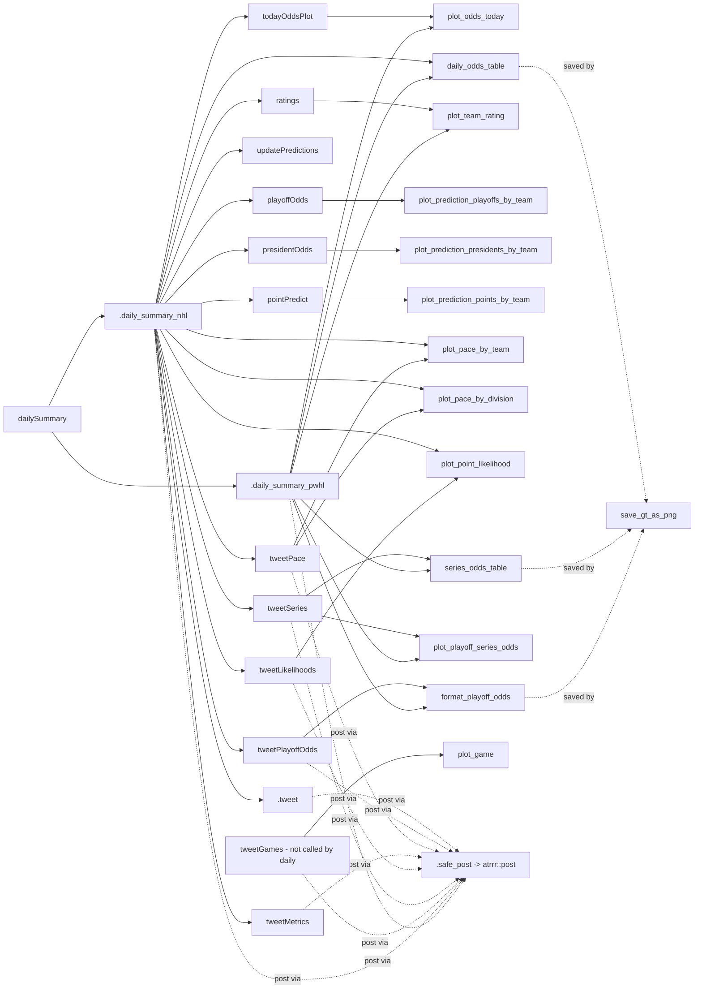

# Graphics & table products (NHL + PWHL)

Reference for every plot, table, image file, and text product made by HockeyModel, so agents don't have to re-read the source. Written from `R/` source (Oct 2026). Line numbers are approximate. Items marked **(?)** were not fully verified.

## Contents

1. [Summary tables](#1-summary-tables)
2. [Call graph](#2-call-graph)
3. [Shared helpers, themes, colours, logos](#3-shared-helpers-themes-colours-logos)
4. [Graphics functions (ggplot)](#4-graphics-functions-ggplot)
5. [Table functions (gt)](#5-table-functions-gt)
6. [Front-end wrappers](#6-front-end-wrappers)
7. [Daily summary & social posting workflow](#7-daily-summary--social-posting-workflow)
8. [Text / export products](#8-text--export-products)
9. [Caching & data dependencies](#9-caching--data-dependencies)
10. [Gotchas & inconsistencies](#10-gotchas--inconsistencies)

---

## 1. Summary tables

### 1a. Product functions

| Function | File | Output | Leagues | Saves file itself? |
|---|---|---|---|---|
| `plot_odds_today()` | graphics-odds.R | ggplot (stacked fill bars, coord_flip) | NHL, PWHL (`league=`) | NHL only: appends CSV `./<season8>.csv` |
| `plot_playoff_series_odds()` | graphics-odds.R | ggplot | NHL, PWHL (`league=`, `teamColours=`) | no |
| `plot_game()` | graphics-plots.R | ggplot (goal distribution areas) | NHL only | no |
| `plot_point_likelihood()` | graphics-plots.R | named list of ggplots (one per conference) | NHL only | yes (`savefiles=TRUE`) |
| `plot_team_rating()` | graphics-plots.R | ggplot (offence/defence scatter) | NHL, PWHL (`league=`) | no |
| `plot_prediction_points_by_team()` | graphics-predictions.R | ggplot (bspline trend by division facet) | both (pass `teamColours`) | no |
| `plot_prediction_playoffs_by_team()` | graphics-predictions.R | ggplot | both (pass `teamColours`) | no |
| `plot_prediction_presidents_by_team()` | graphics-predictions.R | ggplot | both (pass `teamColours`) | no |
| `plot_pace_by_division()` | graphics-pace.R | writes PNG per division; returns last ggplot | NHL only | yes |
| `plot_pace_by_team()` | graphics-pace.R | writes PNG per team; returns NULL | NHL only | yes |
| `format_playoff_odds()` | graphics-tables.R | gt | NHL, PWHL (`league=`) | no |
| `daily_odds_table()` | graphics-tables.R | gt (or NULL if no games) | NHL, PWHL | no |
| `series_odds_table()` | graphics-tables.R | gt | NHL, PWHL | no |
| `save_gt_as_png()` | gt_image_export.R | PNG file; returns filename invisibly | — | yes |
| `.formatPredsForHockeyVisContest()` | utils-export.R | character(1) | NHL only | no |

### 1b. Image files written by the workflows

All ggplot PNGs use `grDevices::png(width = 11, height = 8.5, units = "in", res = 300)`, so they are 3300×2550 px. gt PNGs go through `save_gt_as_png()` and are sized automatically (150 dpi plus 20 px padding).

| File (relative to graphic dir) | Producer | Writer | League |
|---|---|---|---|
| `today_odds.png` | `todayOddsPlot()` | `.daily_summary_nhl` | NHL |
| `today_odds_table.png` | `daily_odds_table()` | `.daily_summary_nhl` | NHL |
| `current_rating.png` | `ratings()` | `.daily_summary_nhl` (written twice) | NHL |
| `playoff_odds.png` | `playoffOdds()` (ggplot), **or** `format_playoff_odds()` gt in playoffs | daily / `tweetPlayoffOdds(trimcup=TRUE)` | NHL |
| `president_odds.png` | `presidentOdds()` | daily | NHL |
| `point_predict.png` | `pointPredict()` | daily | NHL |
| `eastern_playoff_odds.png`, `western_playoff_odds.png` | `format_playoff_odds()` per conference | `tweetPlayoffOdds()` | NHL |
| `series_odds.png`, `series_odds_table.png` | series plot / table | `tweetSeries()` | NHL |
| `predicted_goals.png` (deleted after posting) | `plot_game()` | `tweetGames()` | NHL |
| `pace/<team_lower_underscored>.png` | `plot_pace_by_team()` | itself | NHL |
| `pace/<division_lower>_pace.png` | `plot_pace_by_division()` | itself | NHL |
| `pace/<conf_lower>likelihood.png` | `plot_point_likelihood()` | itself | NHL |
| `pwhl_today_odds.png`, `pwhl_today_odds_table.png` | `plot_odds_today` / `daily_odds_table` | `.daily_summary_pwhl` | PWHL |
| `pwhl_current_rating.png` | `plot_team_rating(league="PWHL")` | PWHL daily | PWHL |
| `pwhl_series_odds.png`, `pwhl_series_odds_table.png` | series plot / table | PWHL daily | PWHL |
| `pwhl_playoff_odds.png` (a gt table) | `format_playoff_odds(league="PWHL")` | PWHL daily | PWHL |

Default directories (`frontend-core.R` ~L106–125):
- NHL: `getOption("HockeyModel.graphics.path", "./prediction_results/graphics")`
- PWHL: `file.path(getOption("HockeyModel.prediction.path", "./prediction_results"), "pwhl_graphics")`

The `tweet*()` functions default to `getOption("HockeyModel.graphics.path")` **with no fallback**.

---

## 2. Call graph

`PO`, `PRO`, and `PP` read prediction snapshots through `.league_predictions()` → `compile_predictions()`.

---

## 3. Shared helpers, themes, colours, logos

**Colours**
- Colour data sets are `HockeyModel::teamColours` (NHL) and `HockeyModel::pwhlTeamColours` (PWHL). Columns used: `Team`, `Hex`, `AltHex`, `Division`, `ShortCode`, and `Hashtag` (NHL posts only).
- `getTeamColours(home, away, delta = 0.15, teamColours)` (graphics-utils.R ~L18) picks home/away hexes. It tries primary/primary first, then falls back through the alternates until `colourDelta()` ≥ `delta`. If nothing passes, it uses the best delta and prints "No Great Colour Separation". It **aborts** if a team is missing from the table.
- `colourDelta(hex1, hex2)` returns the mean absolute RGB difference on a 0–1 scale. `hexToRGB(hex)` converts a hex code to RGB. Both are exported.
- In trend, rating, pace, and likelihood plots, colours are a named vector `Hex` keyed by `Team` and passed to `scale_colour_manual` / `scale_fill_manual`.
- `.getTeamDivisions()` and `.getShortTeam()` (nhl-team-season-lookup.R ~L337/357) both take a `teamColours` argument; this is how PWHL support works in the prediction plots.
- `.prediction_facet_levels()` orders facets as Pacific, Central, Metropolitan, Atlantic, then any other divisions (PWHL).

**Themes**
- `theme_bw` plus a stripped y axis: `plot_odds_today`, `plot_playoff_series_odds`.
- `theme_minimal`: game, rating, prediction, and pace plots.
- `ggridges::theme_ridges`: likelihood plots.
- No shared theme function exists. The caption `"P. Bulsink (@bot.bulsink.ca) | <Sys.Date()>"` is hard-coded in every plot. gt subtitles hold `"Generated <date> | P. Bulsink (@bot.bulsink.ca)"` (or `"For games <today> | …"` in `daily_odds_table`).

**gt styling**
- `daily_odds_table` and `series_odds_table`: a 3-colour scale `#cc3c3c → #ffffff → #3c3ccc` on win/series odds.
- `format_playoff_odds`: a 2-colour scale `#fefffe → #3ccc3c`.
- A blank `block` (or `homeblock`/`awayblock`) column is filled with the team `Hex`.

**Logos**
- Path: `file.path(getOption("HockeyModel.data.path"), "logos", tolower(gsub(" ", "_", team)) ".png")`, inserted with `gt::local_image(height = "30px")`.
- Fallback is `nhl.png` or `pwhl.png`. `series_odds_table` uses a local helper `.team_logo_path()`; the other two tables inline the same logic.
- Logos appear **only in gt tables**. ggplots use no logos.

**Optional dependencies**
- Each function checks for ggplot2, gt, scales, ggforce (trend plots), ggridges (likelihood), and ragg (PNG fallback) with `requireNamespace` and aborts if one is missing.
- ggrepel is optional: labels are silently skipped if it is absent.

---

## 4. Graphics functions (ggplot)

### `plot_odds_today(today, params, schedule, teamColours, league)` — graphics-odds.R ~L15
- **Shows:** a horizontal stacked bar per game. From away to home: AwayWin, AwayWinOT, HomeWinOT, HomeWin. OT segments use alpha 0.7. Team names and 3-dp labels are annotated.
- **Data:** `.todayDC(today, params, schedule)` returns HomeTeam, AwayTeam, HomeWin, AwayWin, Draw, GameID. OT shares come from `.extraTimeSolver()`.
- **Returns:** `NULL` when there are no games.
- **League differences:**
  - PWHL replaces `teamColours` with `pwhlTeamColours` and uses the title "…Today's PWHL Games".
  - NHL **appends the odds to `./<getCurrentSeason8()>.csv` in the working directory** (a side effect).
- `params` is always parsed with `.parse_dc_params()`, even for PWHL **(?)**: this assumes the PWHL params have already been parsed.

### `plot_playoff_series_odds(series = getAPISeries(), params, teamColours, league)` — ~L220
- **Inputs:** `series` with columns HomeTeam, AwayTeam, HomeWins, AwayWins. Odds come from `playoffWin()` through `purrr::pmap_dbl`.
- **Shows:** a 2-segment bar per series with labels like `odds (wins)`.
- **League differences:** PWHL changes only the title. Unlike `plot_odds_today`, it does **not** auto-swap colours, so the caller must pass `pwhlTeamColours`; the PWHL daily summary does this.

### `plot_game(home, away, params, maxgoal = 10)` — graphics-plots.R ~L12
- **Shows:** overlapping goal-probability areas from `.dcProbMatrix`, with dashed xG lines at λ and μ. The subtitle gives win/OT odds from `DCPredict(home, away)`.
- **NHL only:** `getTeamColours` uses its NHL default.
- **Bug:** `DCPredict` is called without `params`, so the subtitle uses the default model.

### `plot_point_likelihood(preds = NULL, graphic_dir, subdir = "pace", savefiles = TRUE)` — ~L171
- **Shows:** ridgeline densities of final points per team, faceted by conference, with median lines.
- **Inputs:** with `preds = NULL` it **runs `loopless_sim(nsims = 1e4)`**, which is slow. Expects `raw_results` with columns `Team` and `Points`.
- **Output:** a named list of ggplots. With `savefiles = TRUE` it writes `<graphic_dir>/<subdir>/<conf_lower>likelihood.png`.
- **NHL only:** the x range `from = 40, to = 130` is hard-coded, and the title uses `getCurrentSeason8()`.
- `element_line(size = )` is deprecated in ggplot2 ≥ 3.4.

### `plot_team_rating(m = HockeyModel::m, teamlist = NULL, league)` — ~L282
- **Shows:** a scatter of standardised Attack against inverted Defence. Corner labels read Bad, Good, Calm, Frantic, and team labels are repelled.
- **Coefficients:** Attack is taken from the first n coefficients and Defence from the next n−1 (the first team is set to 0). **This is fragile:** it depends on the glm coefficient order and the `sort(teamlist)` order matching.
- **League differences:** PWHL uses its own colours and title. Call it with `m = HockeyModel::pwhl_m`.

### Prediction trend plots — graphics-predictions.R
These are `plot_prediction_points_by_team` (~L26), `plot_prediction_playoffs_by_team` (~L126), and `plot_prediction_presidents_by_team` (~L247).
- **Inputs:** `all_predictions` (default `compile_predictions()`) needs the columns `predictionDate`, `Team`, `meanPoints`, `Playoffs`, and `Presidents`. Also `past_days = 14` and `teamColours`. The presidents plot adds `minimum = 0.01` and drops teams below that.
- **Shows:** `ggforce::geom_bspline` lines, faceted by division (one row), with end labels like `SHORT\nvalue`. Playoff labels use the forms `~100`, `>99.5`, `<0.5`, and `~0`.
- **PWHL:** pass `teamColours = HockeyModel::pwhlTeamColours`; the frontend wrappers do this. Titles do **not** name the league.
- PWHL snapshots are written by `.update_predictions_pwhl` (frontend-core.R ~L245) as `.pwhl_prediction_summary()` (Team, Playoffs, meanPoints, Presidents), saved under `<prediction.path>/pwhl/`.

### Pace plots — graphics-pace.R (NHL only)
- **Common inputs:**
  - `scores`, filtered to `Date >= getSeasonStartDate()`. The division plot also filters to `GameType == "R"`.
  - The season-start snapshot `<prediction_dir>/<getSeasonStartDate()>-predictions.RDS` (needs `meanPoints` and `sdPoints`).
  - `.getNumGames()`.
- Points per game are approximated as `ceiling(2 * Result)`. **(?)** This assumes `Result` is in {0, 0.4/0.6, 1}, so OT losses count as 1 point.
- **`plot_pace_by_division` (~L12):**
  - Plots cumulative points minus the pro-rated expected points (`geom_smooth`, span 0.2) for each division.
  - Writes `pace/<division lower, underscores>_pace.png`.
  - Returns **only the last division's plot**.
- **`plot_pace_by_team` (~L201):**
  - Plots cumulative points by venue. Grey fan: season-start mean ±2 sd. Team-coloured fan: latest snapshot mean ±2 sd, starting from the current point.
  - Writes `pace/<team>.png` and returns NULL.

---

## 5. Table functions (gt)

### `format_playoff_odds(playoff_odds, caption_text = "", trim = TRUE, trimcup = FALSE, league)` — graphics-tables.R ~L17
- **NHL:**
  - Expects the columns Team, Make_Playoffs, Win_First_Round, Win_Second_Round, Win_Conference, Win_Cup **in exactly that order**. Colouring and percent formatting use `columns = 4:8`, so any extra column such as `Conference` must be removed first; `tweetPlayoffOdds` does this for its per-conference tables.
  - Sorted by Cup, then deeper rounds.
  - `trim` drops teams with a 0 playoff chance; `trimcup` drops teams with a 0 Cup chance.
  - Title: `"<caption_text> NHL Playoff Odds"`.
- **PWHL:**
  - Selects Team, Make_Playoffs, Make_Finals, Win_Cup, meanPoints, meanRank (taken from `pwhl_loopless_sim()$summary_results`).
  - `trim` and `trimcup` are ignored.
  - Title: `"<caption_text> Playoff Odds"` (the daily summary passes "PWHL").

### `daily_odds_table(today, params, schedule, league)` — ~L193
- **Columns:** home block, home logo, HomeTeam, HomexG, HomeWin | AwayWin, AwayxG, AwayTeam, away logo, away block.
- **Data:** xG comes from `.dcxG()`. Win odds are normalised with `normalizeOdds()`, so the regulation draw is redistributed.
- **League differences:** PWHL changes the title ("PWHL Game Odds"), the colours, and the logo fallback.
- Returns NULL when there are no games.
- `include_images` is always TRUE, which is dead branching.

### `series_odds_table(series = getAPISeries(), params, league)` — ~L416
- **Validation:** checks the required columns and their types (character team names, numeric wins). If a `Status` column is present, it keeps only `"Ongoing"` rows.
- **Data:** odds come from `playoffWin()` via `mapply`.
- **League differences:** the source note is hard-coded as "Best of 7" (NHL) or "Best of 5" (PWHL).
- **Bug:** `gt::md()` is applied twice (`series_note` is already md).

### `save_gt_as_png(gt_table, filename, width = NULL, height = NULL, dpi = 150, scale = 1, padding = 20)` — gt_image_export.R ~L26
1. **First tries `gt::gtsave()`**, which uses webshot2/chromote. On error it only prints an alert.
2. If the file was written after the start time, it returns.
3. Otherwise it falls back to `gt::as_gtable()` and `ragg::agg_png`. The size is auto-detected by measuring the grob on a null PDF device.

The roxygen says "no webshot/chrome required", but the code tries webshot first. **(?)** Whether `local_image` logos render on the gtable/ragg path depends on the gt version.

---

## 6. Front-end wrappers

These live in frontend-plots.R. Each takes `league = NULL` (both leagues) or `"nhl"`, `"pwhl"`, or `"both"` (case-insensitive), resolved by `.resolve_frontend_leagues()`. For one league the result is the plain object; for both it is `list(nhl=, pwhl=)` (`.simplify_frontend_result`). Arguments can be league-named lists, picked apart by `.frontend_value_for_league()`.

| Wrapper | NHL target | PWHL target |
|---|---|---|
| `todayOddsPlot(date, params, schedule, scores, league)` | `plot_odds_today(league="NHL")`. Checks games with `games_today()` and warns if scores are more than 7 days old. | Same, with `pwhl_games_today()`, `.parse_pwhl_dc_params`, `pwhlSchedule`, `pwhlScores` |
| `playoffOdds(data_dir, league)` | `plot_prediction_playoffs_by_team` on `data_dir` | same, on `data_dir/pwhl` with PWHL colours |
| `presidentOdds(data_dir, league)` | `plot_prediction_presidents_by_team` | same, on `/pwhl` |
| `pointPredict(data_dir, league)` | `plot_prediction_points_by_team` | same, on `/pwhl` |
| `ratings(m, league)` | `plot_team_rating(HockeyModel::m)` | `plot_team_rating(HockeyModel::pwhl_m, "PWHL")` |

Season predicates in frontend-season.R (`inRegularSeason`, `inPlayoffs`, `inOffSeason`) take the same `league` argument and gate the workflows.

---

## 7. Daily summary & social posting workflow

`dailySummary(graphic_dir, subdir = "pace", delay = runif(2–6 min), league = NULL)` (frontend-daily-summary.R ~L299) runs `.daily_summary_nhl` and/or `.daily_summary_pwhl`. If `graphic_dir` is omitted, PWHL uses its own default directory.

### Posting primitives (frontend-social.R)
- `.safe_post(description, ...)` wraps `atrrr::post(text, image, image_alt)` (Bluesky) in `tryCatch`. It returns `list(description, success, error)`.
- `.summarize_post_results()` turns those results into a `data.frame(description, success, error)` and warns about failures.
- Every `tweet*` function returns this data frame invisibly.
- `.daily_summary_nhl` binds the results and warns with the failure count.
- **Despite the "tweet" names, posting goes to Bluesky via atrrr.**

### NHL sequence (`.daily_summary_nhl`)
1. **Gating:** if `inOffSeason`, it `stop("Offseason")` unless the season starts within 7 days. It also `stop`s if no future games exist.
2. Run `updateModel("NHL")` and parse the params.
3. **If `games_today()`:**
   - Save `today_odds.png` and `today_odds_table.png`.
   - Post the table, then the plot, with no delay between them.
   - Save and post `current_rating.png`.
4. **If in the regular season:**
   - Run `updatePredictions()`, which writes the dated snapshot.
   - Build playoff, president, and point plots and the rating plot.
   - Save `playoff_odds.png`, `president_odds.png`, `point_predict.png`, and `current_rating.png`.
   - Run the pace-by-team, pace-by-division, and likelihood generators. The likelihood generator runs a fresh 1e4-sim run.
5. **`.tweet()`** (regular season only) posts point_predict, playoff_odds, and president_odds, with `delay` between each. Then `Sys.sleep(delay)`.
6. **Playoff odds:**
   - Regular season: `tweetPlayoffOdds(params)` runs `simulatePlayoffs`, saves East/West gt tables, and posts both. Then it sleeps `delay/2`.
   - Playoffs: `tweetPlayoffOdds(trimcup = TRUE)` builds a single table, saves it to `playoff_odds.png`, and posts it.
7. **Weekday extras** (regular season only):
   - Monday: `tweetPace()`. It re-runs `updateScoresAPI` and both pace generators, then posts each team (text includes initial vs current meanPoints and the team Hashtag), a recap text post (above/below expectation), and each division image.
   - Sunday: `tweetMetrics()`, a text-only post of LogLoss and Accuracy from `getSeasonMetricsDC()`.
   - Tuesday: `tweetLikelihoods()`, which posts each conference image only if the file's mtime is today.
8. **Series:** if `getAPISeries()` has `"Ongoing"` series, run `tweetSeries()`. It saves and posts `series_odds.png`, sleeps `delay`, then saves and posts `series_odds_table.png`.
9. `tweetGames()` posts per-game `plot_game` images with hashtags; it is **not** called by the daily workflow.

### PWHL sequence (`.daily_summary_pwhl`, pwhl-daily-summary.R)
1. **Gating:** off-season or no scheduled games produce an info message and an empty summary. It does not `stop()`, unlike NHL.
2. Run `.update_model_pwhl()` and `.parse_pwhl_dc_params()`.
3. **If there are games today** (`pwhl_games_today`):
   - Post `pwhl_today_odds.png`.
   - Sleep `delay`, then post `pwhl_today_odds_table.png`.
   - Rating plot: wrapped in `tryCatch` → NULL; sleep `delay`, then post `pwhl_current_rating.png`.
4. **Series** (`getPWHLPlayoffSeries()`, any rows):
   - Series plot with PWHL colours → `pwhl_series_odds.png`.
   - Series table → `pwhl_series_odds_table.png`.
   - Each is wrapped in `tryCatch` and posted after a `delay`.
5. **`pwhl_in_season()` with regular-season games remaining:**
   - Run `pwhl_loopless_sim(1e4)` and `format_playoff_odds(league = "PWHL")` → `pwhl_playoff_odds.png`.
   - Sleep `delay`, then post.
6. Not done for PWHL: no trend plots (playoff, president, points), no pace or likelihood plots, no metrics post, and **no `updatePredictions` call**, so no snapshot is saved in this path.

Post text: NHL uses `#NHL`/`#HockeyTwitter`/`#StanleyCup` and team hashtags; PWHL uses `#PWHL`. Every image post carries `image_alt` text.

---

## 8. Text / export products

- `.formatPredsForHockeyVisContest(predictions, candyType = "Fuzzy Peaches", handle = "@bot.bulsink.ca")` (utils-export.R ~L11) builds the HockeyViz contest string. The format is Python-dict-like, holding per-team `(meanPoints, sdPoints)` for 32 hard-coded NHL abbreviations. NHL only; internal.
- `plot_odds_today` appends a CSV (NHL only; see §4).
- `tweetMetrics` and the pace recap are text-only posts.

---

## 9. Caching & data dependencies

- **No memoisation or explicit cache.** Files on disk act as the cache:
  - **Prediction snapshots:** `<HockeyModel.prediction.path>/<YYYY-MM-DD>-predictions.RDS` for NHL and `<…>/pwhl/<date>-predictions.RDS` for PWHL. `compile_predictions()` (nhl-league-simulation.R ~L259) reads all of them through `.get_prediction_dates()`. The PWHL updater skips a date that already exists (frontend-core.R ~L265).
  - **Pace plots:** need the season-start snapshot `<getSeasonStartDate()>-predictions.RDS`. Without it, `readRDS` errors.
  - **`tweetLikelihoods`:** uses the file mtime as a freshness check.
  - **`save_gt_as_png`:** checks the mtime to detect whether `gtsave` succeeded.
- **Options used:** `HockeyModel.graphics.path`, `HockeyModel.prediction.path`, `HockeyModel.data.path` (logos).
- **Packaged data used:** `teamColours`, `pwhlTeamColours`, `m`, `pwhl_m`, `schedule`, `scores`, `pwhlSchedule`, `pwhlScores`.

---

## 10. Gotchas & inconsistencies

1. **Pace filename mismatch (real bug).** `plot_pace_by_division` writes `tolower(gsub(" ","_",division))_pace.png` (e.g. `atlantic_pace.png`), but `tweetPace` posts `paste0(division, "_pace.png")` (e.g. `Atlantic_pace.png`). Posting fails on case-sensitive filesystems (Linux, Raspberry Pi).
2. **`playoff_odds.png` is overwritten.** It holds the ggplot trend chart in the regular season but the gt table in the playoffs (`tweetPlayoffOdds(trimcup=TRUE)`).
3. **`current_rating.png` is rendered twice** in the NHL daily run, and ratings are posted only on days with games.
4. **Repeated slow simulations.** `plot_point_likelihood()` with no `preds` runs its own 1e4-sim simulation, and `tweetLikelihoods` calls it again.
5. **`!is.na(series)` on a data frame** (daily NHL ~L256) gives a matrix inside `&&`. This errors in R ≥ 4.3 when length > 1. **(?)** It depends on what `getAPISeries()` returns off-season.
6. **`plot_game` ignores `params` in `DCPredict`.** It also uses NHL colours only.
7. **CSV side effect.** `plot_odds_today` appends a CSV to the working directory (NHL).
8. **Subtitle dates ignore the `today` argument.** `plot_odds_today` uses `Sys.Date()` in its subtitle; `daily_odds_table` uses `today`.
9. **Colour handling is inconsistent across functions:**
   - `plot_odds_today` swaps to PWHL colours itself.
   - `plot_playoff_series_odds` and the trend plots need `teamColours` passed in.
   - `plot_team_rating` and the tables choose colours by `league`.
10. **Unused or ignored arguments.** `tweetPace` ignores its `scores` argument (it re-fetches). `tweetLikelihoods` never uses `scores`.
11. **`dailySummary` return value.** The roxygen says it returns `NULL` for one league, but it actually returns the post-summary data frame.
12. **NHL vs PWHL control flow differs.** NHL `stop()`s in the off-season or with no future games; PWHL returns quietly. NHL has no `tryCatch` around plot generation; PWHL does.
13. **Contest string has a Utah bug** (utils-export.R). `UTA` uses `meanPoints` for "Utah Mammoth" but `sdPoints` for "Utah Hockey Club".
14. **`series_odds_table` has a double `gt::md()`** and hard-coded series lengths (7 for NHL, 5 for PWHL).
15. **`format_playoff_odds` (NHL) depends on column position** (`4:8`).
16. **Deprecated ggplot2 arguments.** `element_line(size=)` in the likelihood plot; `legend.position = c(x, y)` in `plot_game` (deprecated in ggplot2 3.5).
17. **Misleading roxygen.** `save_gt_as_png` claims "no webshot" but tries `gtsave` first.
18. **`tweet*` graphic-dir defaults** have no fallback when `HockeyModel.graphics.path` is unset; `file.path(NULL, …)` gives `character(0)`.
19. **No league names in some titles.** Trend-plot titles and the likelihood plot are not league-labelled, so PWHL trend plots look identical to NHL ones apart from team names.
