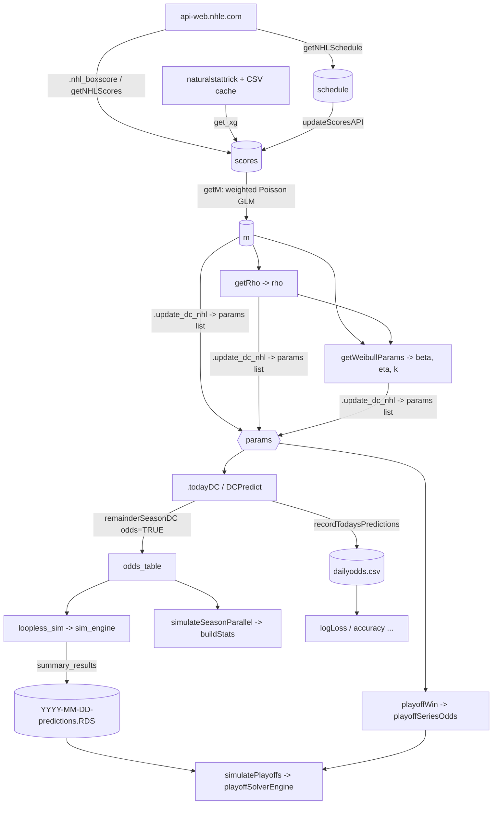

# NHL model reference (for agents)

Read this before calculation or modelling work, so you don't have to explore `R/` first. It covers the NHL only; PWHL has its own files (`pwhl-*.R`). Line numbers are approximate. Items marked **(?)** are unverified or look like bugs. Confirm them before you rely on them.

## Contents

1. [Data flow](#1-data-flow)
2. [Data ingestion and caching](#2-data-ingestion-and-caching)
3. [Bundled data and key columns](#3-bundled-data-and-key-columns)
4. [Dixon-Coles fit](#4-dixon-coles-fit)
5. [Prediction (incl. OT/SO)](#5-prediction-incl-otso)
6. [Season simulation](#6-season-simulation)
7. [Standings and tiebreakers](#7-standings-and-tiebreakers)
8. [Playoff / cup simulation](#8-playoff--cup-simulation)
9. [Predictions log and metrics](#9-predictions-log-and-metrics)
10. [Tuning and audits](#10-tuning-and-audits)
11. [Constants and magic numbers](#11-constants-and-magic-numbers)
12. [Function tables](#12-function-tables)
13. [Conventions](#13-conventions)
14. [Gotchas and inconsistencies](#14-gotchas-and-inconsistencies)

---

## 1. Data flow

The daily driver is `dcPredictMultipleDays()` (`nhl-dixon-coles-workflow.R` ~461). For each date it refits the parameters with `.update_dc_nhl`, runs `loopless_sim`, and saves the RDS file. If that fails, it falls back to `remainderSeasonDC`. `updateModel()` and `updatePredictions()` sit in `frontend-core.R`, which is outside this document's scope.

## 2. Data ingestion and caching

File: `nhl-api-fetch.R`.

- **HTTP:** every call uses `httr2::request() |> req_cache(tempdir()) |> req_retry(max_seconds = 120)`, so the cache lasts only for the session. `.NHL_API_FIELDS` (~L4) lists the JSON field names but isn't used consistently.
- **`getNHLSchedule(season)`:**
  - Loops over each `teamColours$ShortCode` and calls `/v1/club-schedule-season/{abbr}/{season}`.
  - Keeps `gameType` 2 → `"R"` and 3 → `"P"`.
  - Maps abbreviations to full names with `.getLongTeam`, then dedupes.
  - **Moves any past game still marked `FUT`/`PPD` to `max(sched$Date)`.**
- **`games_today(schedule, date)`:** calls `/v1/schedule/{date}` and keeps only the schedule rows whose IDs appear in the API response. It drops `PPD`/`RESCHEDULED` games unless `all_games = TRUE`.
- **`getNHLScores(gameIDs)`:** calls `/v1/gamecenter/{id}/boxscore` and keeps only `gameState == "OFF"`.
  - `OTStatus` comes from the period number:
    - period ≤ 3 → `""`
    - period 5 in regular season → `"SO"`
    - period > 3 otherwise → `"OT"` (so playoff multi-OT becomes `"OT"`)
  - It aborts on an NA `OTStatus`, on tied final scores, or on an NA `Result`.
  - It then left-joins `get_xg()`.
- **`get_xg(gameIds)`:** uses the `naturalstattrick` package. Games before 2007 get NA. Results are cached to CSV by `.load_or_get_nst()` at `getOption("HockeyModel.nst.cache.path", "~/Documents/natstattrick.csv")`.
- **`updateScoresAPI(scores, schedule, full_season, save_data)`:**
  - Re-fetches past games not yet `Final`; with `full_season = TRUE`, it re-fetches every game since season start.
  - Replaces those rows, arranges by date, and optionally runs `usethis::use_data(scores)`.
- **`updateScheduleAPI(save_data)`:** fetches the current season's schedule and optionally saves it with `use_data`.
- **`.clean_names()`:**
  - Transliterates to ASCII.
  - Chains franchise renames: Phoenix → Arizona → Utah Hockey Club → **Utah Mammoth**; Atlanta → Winnipeg; Minnesota North Stars → Dallas; Quebec → Colorado.
  - Folds `2OT…8OT` into `OT`.
  - Applies to the `HomeTeam`/`AwayTeam`/`Team`/`name` columns.
- **`getAPISeries(season, wins_required = 4)`:** calls `/v1/playoff-bracket/{endYear}` and returns `Round, Series (letter), HomeTeam (top seed), AwayTeam, HomeWins, AwayWins, HomeSeed, AwaySeed, Status ("Complete"/"Ongoing")`. TBD series are dropped.
- **Season helpers** (`nhl-team-season-lookup.R`) query `api.nhle.com/stats/rest/en/season`:
  - `getSeasonStartDate`, `getSeasonEndDate` and `getCurrentSeason8` take the last row of the response.
  - `getSeason(date)` returns an 8-character ID such as `"20242025"`, or `NULL`.
  - `.getNumGames(season)` returns the number of games in the season.
  - `.in_regular_season_nhl`, `.in_off_season_nhl` and `.in_playoffs_nhl` fall back to `schedule` if the API fails.
- **Team lookups:** `.getTeamConferences`, `.getTeamDivisions`, `.getShortTeam` and `.getLongTeam` read `teamColours` (`Team`, `ShortCode`, `Conference`, `Division`).

## 3. Bundled data and key columns

File: `data.R`. The data lives in `data/`, and `HockeyModel::x` is the default argument almost everywhere.

| Object | Contents |
|---|---|
| `scores` | `Date, HomeTeam, AwayTeam, HomeGoals, AwayGoals, OTStatus ("", "OT", "SO"), GameID, GameType ("R"/"P"), GameStatus ("Final"), Result, HomexG, AwayxG` + NST advanced columns (`Home/Away{G,CF,xG}{,pk,pp}`) |
| `schedule` | `Date, HomeTeam, AwayTeam, GameID, GameStatus (API gameState: FUT, OFF, PPD…), GameType` |
| `m` | Trimmed `glm` (Poisson); `m$data` keeps `Date, GameID, Weight, Team, Opponent, Goals, Home` |
| `rho` | about −0.25 |
| `beta`, `eta`, `k` | Weibull shape (~2), scale (~3), multiplier (~5–6) |
| `teamColours` | team name, colours, `ShortCode`, `Conference` ("Eastern"/"Western"), `Division` |

**`Result` coding** (always from the home team's view): 1 = regulation win, 0.75 = OT win, 0.6 = SO win, 0.5 = tie (historical games only), 0.4 = SO loss, 0.25 = OT loss, 0 = regulation loss. The away team's result is `1 - Result`.

**`params` list:** `list(m, rho, beta, eta, k)`. `.parse_dc_params()` (`nhl-dixon-coles-fit.R` ~462) unwraps nested `$params` entries and fills any missing element from the package data.

## 4. Dixon-Coles fit

File: `nhl-dixon-coles-fit.R`.

**`getM(scores, currentDate, xi, upsilon, nu)`** (~L47)

1. Trims to games where `Date >= currentDate - 4000` (about 11 seasons).
2. Computes weights with `.DCweights()`. Season start dates are derived only when `nu != 0`.
3. Builds a long data frame with 2 rows per game (home row `Home = 1`, away row `Home = 0`). The home rows come first and the away rows second.
4. Fits `glm(Goals ~ Team + Opponent + Home + 0, family = poisson(log), weights = Weight)`. Coefficients are named `Team<name>`, `Opponent<name>` and `Home`.
5. Shrinks the model with `.cleanModel()`, which removes `y`, `model`, `residuals`, `qr$qr`, `weights` and so on.

Expected goals come from:
- home: $\lambda=\exp(\text{Team}_h+\text{Opp}_a+\text{Home})$
- away: $\mu=\exp(\text{Team}_a+\text{Opp}_h)$

**Time-decay weights `.DCweights()`** (~L369)

$$w=\Big(1-\frac{1}{1+e^{-\xi(d-\upsilon)}}\Big)\cdot\frac{1}{1+s^{\nu}}$$

- $d$ is the game's age in days. Games with $d \le 0$ (today or later) get weight 0.
- $s$ is the number of seasons back, found with `findInterval` over season starts from `.derive_season_starts()` (the season begins in month ≥ 8).
- NHL defaults: $\xi=0.00426$, $\upsilon=365$, $\nu=0$, so the cross-season factor is off.

**`getRho(m, scores)`** (~L135)

- Uses Brent `optim` on $[-0.5, 0.5]$ to maximise the weighted `.DCRhoLogLik`: $\sum w[\log\tau+\log P(y_1)+\log P(y_2)]$.
- `tau()` is a vectorised `.tau_singular`:
  - $\tau(0,0)=1-\lambda\mu\rho$
  - $\tau(0,1)=1+\lambda\rho$
  - $\tau(1,0)=1+\mu\rho$
  - $\tau(1,1)=1-\rho$
- $\tau$ is floored at `double.xmin`.
- It warns if `optim` doesn't converge.

**`getWeibullParams(m, rho, scores)`** (~L217)

- This is a tie enhancement, because hockey teams play for the tie late in games.
- For each tied game (Result 0.25/0.4/0.5 → `HomeGoals + 1`; 0.6/0.75 → `AwayGoals + 1`), $x$ = tie score + 1.
- $R_x = 2\cdot\frac{P(\text{tie at }x)}{P(\text{non-tie with a team at }x)}$.
- Fits $\min\sum_x(R_x-k\cdot\text{dweibull}(x;\beta,\eta))^2$ with L-BFGS-B. Start values are (3, 1, 6); bounds are lower (1e-6, 1e-6, −2) and upper (10, 10, 100).
- Returns `list(beta, eta, k)`.
- The fit is **unweighted**: a `weight` column is computed but never used.

**`.update_dc_nhl(scores, currentDate, xi, upsilon, nu, save_data)`** (`nhl-dixon-coles-workflow.R` ~L24)

- Runs `getM`, then `getRho`, then `getWeibullParams` → `params`.
- If `currentDate != Sys.Date()`, it filters `scores` to `Date < currentDate` and forces `save_data = FALSE`.
- Otherwise it saves `m, rho, beta, eta, k` with `usethis::use_data`.

## 5. Prediction (incl. OT/SO)

File: `nhl-dixon-coles-predict.R`.

**Expected goals: `.dcLambda(home, away, params)`** (~L355)

- Calls `predict(params$m, …, type = "response")`.
- If that fails (an unseen team), it calls `.DCPredictErrorRecover()`, which works as follows:
  - Unseen team: uses the minimum `Team` coefficient.
  - Unseen opponent: uses the maximum `Opponent` coefficient.
  - Both unseen: uses historical constants, 3.319624 at home and 2.827417 away.
  - It always uses `HockeyModel::m`, not `params$m`.

**Adjustments, in order (`.dcProbMatrix`, ~L534)**

1. **Regression to the mean** (only when both `expected_mean` and `season_percent` are set): $\lambda'=\lambda(1-\tfrac{p}{3})+\bar g\cdot\tfrac{p}{3}$, with $\bar g$ = `expected_mean` and $p$ = `season_percent`; the same applies to $\mu$.
2. **Back-to-back (b2b)** via `.apply_b2b()`:
   - Home team on b2b: $\lambda\cdot e^{-0.037}$ and $\mu\cdot e^{+0.037}$.
   - Away team on b2b: $\mu\cdot e^{-0.0645}$ and $\lambda\cdot e^{+0.0645}$.
   - Flags come from `.b2b_flags(games, history)` in `validation-helpers.R` ~L292: a team is flagged if it appears in `history` on `Date - 1`.

**Score matrix: `.prob_matrix(lambda, mu, params, maxgoal, enhance = TRUE)`** (~L635)

- Rows are home goals and columns are away goals, from 0 to `maxgoal`.
1. Takes the outer product of the two Poisson pmfs.
2. Applies the τ scaling to the 2×2 low-score block and clamps negative cells to 0.
3. If `!enhance || k <= 0`, it normalises the whole matrix to sum to 1 and returns it.
4. Otherwise it multiplies the diagonal by `dweibull(1:(maxgoal+1), beta, eta) * k`. If the diagonal sum is ≥ 1, it caps it and warns.
5. It rescales the off-diagonal so the total is 1. Because of this, only the *shape* of the Weibull curve matters, not $k$'s scale.
6. It validates the result with `.validateProbMatrix()`, which clamps small negatives, aborts if the sum is off by more than 1e-3, and renormalises.

`.dcProbArray` and `.dcPredictVectorized` (~L135, ~L210) are vectorised copies of the same logic, used by `.todayDC`. **Keep them in sync with `.prob_matrix`.**

**Outcomes**

- **`DCPredict()`** (~L63):
  - Home win = `sum(lower.tri)`, draw = `sum(diag)`, away win = `sum(upper.tri)`. It returns an **unnamed** vector `c(home, draw, away)` passed through `normalizeOdds`.
  - With `draws = FALSE`, the draw probability is split in proportion to the home and away win probabilities, giving `c(home, away)`.
- **`.dcPredictVectorized()`:** returns a matrix with named columns `HomeWin, Draw, AwayWin`, or `HomeWin, AwayWin` when `draws = FALSE`.
- **Extra time, `.extraTimeSolver(hw, aw, draw)`** (`validation-helpers.R` ~L220):
  - The home team's share of extra-time wins is `0.345 * hw/(hw+aw) + 0.315`.
  - Returns `c(hw, draw*home_ot, draw*(1-home_ot), aw)`, or a 4-column matrix for vector inputs.
- **OT vs SO split:** OT = **0.6858606**, SO = **0.3141394**. These are hard-coded in `dcSample`, `.dcResult`, `.dcExpandedOdds`, `loopless_sim` and the simulation workers.
- **`.dcExpandedOdds()`:** returns six probabilities in the order `[HW, HOT, HSO, ASO, AOT, AW]`, matching the `Result` codes `1, .75, .6, .4, .25, 0`. `.dcResult()` and `.sampleResult()` sample those codes.
- **`dcSample()`:**
  - Draws one score cell.
  - On a tie, it picks OT or SO (p = 0.6858606) and picks the winner using the extra-time split.
  - Returns either a `Result` code or `list(HomeGoals, AwayGoals, OTStatus)`.
- **`.dcxG()`:** returns the expected goals implied by the matrix's margins.

**Daily odds: `.todayDC(params, today, schedule, expected_mean, season_percent, include_xG, draws, history)`** (`nhl-dixon-coles-workflow.R` ~L93)

- Returns a data frame with `HomeTeam, AwayTeam, HomeWin, AwayWin, Draw, GameID`.
- With `include_xG = TRUE`, it adds `Home_xG` and `Away_xG` **and drops `GameID`**.
- `todayOdds()` is an exported wrapper around it.

## 6. Season simulation

There are two engines.

**Shared step: `remainderSeasonDC(..., odds = TRUE)`** (workflow ~L245)

- Calls `.add_postponed_to_schedule_end()`, keeps future games (`Date > max(scores$Date)`), and loops over each day calling `.todayDC` → `odds_table` (`HomeTeam, AwayTeam, HomeWin, AwayWin, Draw, GameID, Date`).
- **Regression to the mean** is on only while future regular-season games remain:
  - `expected_mean = 2.835184`.
  - `season_percent = (d - last_game_date)/season_length`, i.e. it grows the further ahead a game is.
- With `mu_lambda = TRUE`, it returns `lambda`/`mu` per game instead of win probabilities (this branch uses `HockeyModel::m`).
- With `odds = FALSE`, it calls `simulateSeasonParallel()`.

**A. `loopless_sim(nsims, cores, schedule, scores, params, …)`** (`nhl-league-simulation.R` ~L289): the main engine.

1. Builds `odds_table`.
2. Binds this season's played games (`Result` known) to the unplayed ones (`Result` NA).
3. Computes `HomeOT/HomeSO/AwaySO/AwayOT` from `.extraTimeSolver` with draw = `1 - HW - AW`.
4. Runs `sim_engine()`. When `cores > 1`, it runs in parallel with doSNOW/foreach, using `.simulation_chunks` to split exactly `nsims` across workers.
5. Returns `list(summary_results, raw_results)`.
   - `summary_results` columns: `Team, Playoffs, mean/max/minPoints, meanWins, maxWins, Presidents, mean/best/sd Rank, ConfRank, DivRank, sdPoints, sdWins, p_rank1, p_rank2, p_rank_34, p_rank_56, p_rank7, p_rank8`.
   - `p_rank*` are the per-team seeding probabilities used by the playoff simulation.

**`sim_engine(all_season, nsims, params)`** (~L455)

- For each game, it calls `.sampleResult` `nsims` times, or repeats the known `Result` for played games.
- Tallies W/OTW/SOW/L/OTL/SOL per team.
- Points = 2·(W+OTW+SOW) + OTL + SOL.
- Ranking:
  - `Rank` = league rank by points, with **random tie-breaking** (no tiebreak criteria).
  - `ConfRank` and `DivRank` are derived from it.
  - Playoffs = top 3 in each division plus the next 2 by `ConfRank` as wildcards (`Wildcard` 1/2; 100 or 0 means no wildcard).

**B. `simulateSeasonParallel(scores, nsims, schedule, cores, progress, params)`** (~L103): the older engine.

- Precomputes HOT/AOT.
- For each simulation, `.sim_odds_results()` draws two uniforms and `buildStats()` builds full standings.
- The summary has no `ConfRank` or `p_rank*` columns.

**Saved output:** `compile_predictions(dir)` row-binds every `YYYY-MM-DD-predictions.RDS` file and adds `predictionDate`.

## 7. Standings and tiebreakers

File: `nhl-league-standings.R`. `buildStats(scores)` takes either goals plus `OTStatus`, or `Result`.

- Returns `Team, GP, Points, W, L, OTL, OTW, SOL, SOW, Rank, ConfRank, DivRank, Playoffs`. Here `W` means regulation wins only.
- League `Rank` uses `order()` on, in sequence: −Points, −PointPercent, −W, −ROW (W+OTW), −ROSW (+SOW), then a random draw.
  - This is not the official NHL order (RW, ROW, W, head-to-head, goal differential…) **(?)**.
- `ConfRank` and `DivRank` come from `Rank`.
- Playoffs: `DivRank <= 3`, plus two wildcards per conference. See the wildcard bug in §14.

## 8. Playoff / cup simulation

File: `nhl-league-playoffs.R`.

**Single series: `playoffSeriesOdds(home_odds, away_odds, home_win, away_win, ngames = 7, game_home)`** (~L122)

- Exact enumeration of the remaining games with a 2-2-1-1-1 home pattern `T,T,F,F,T,F,T`.
- `home_odds` = P(higher seed wins at home); `away_odds` = P(higher seed wins on the road).
- Returns P(higher seed wins the series). It returns 1 or 0 if the series is already decided.

**`playoffWin(home_team, away_team, home_wins, away_wins, params)`** (~L14)

- Uses `DCPredict(draws = FALSE)` for both venues: `away_odds = 1 - P(away team wins at its home)`.
- `playoffDC()` (workflow ~L198) does the same thing differently: it normalises H/A from the draws version.

**Other series helpers**

- `randomSeriesWinner()` draws a series winner from a lookup table, or calls `playoffWin`.
- `.getAllHomeAwayOdds(teamlist)` precomputes series odds for every ordered team pair (N·(N−1) `playoffWin` calls).

**`simulatePlayoffs(summary_results, nsims, cores, params)`** (~L264)

- If `summary_results` is `NULL`, it loads the latest RDS file, or returns NULL if that file is more than 7 days old.
- Splits teams by conference and calls `playoffSolverEngine()`.
- Seeding per simulation, within each conference:
  - p1 is drawn from `p_rank1`.
  - p2 and p7 are drawn from p1's division using `p_rank_34` and `p_rank_56`.
  - p3 is drawn from the other division using `p_rank2`; p4 and p5 use `p_rank_34` and `p_rank_56`.
  - p6 and p8 are drawn from `p_rank7` and `p_rank8`.
- Bracket:
  - East: s1 = p1–p8, s2 = p2–p7, s3 = p3–p6, s4 = p4–p5. West: s5–s8 the same way.
  - s9 = s1/s2 winners, s10 = s3/s4, s11 = s5/s6, s12 = s7/s8.
  - s13 = s9/s10 (East final), s14 = s11/s12 (West final), s15 = Cup final.
- From round 2 on, home ice is decided by `.reseedTwoTeams()`: higher `meanPoints`, with a random coin flip on ties.
- Output columns: `Team, Make_Playoffs, Win_First_Round, Win_Second_Round, Win_Conference, Win_Cup`.

**`getSeriesOdds(params)`** (~L1232) calls `playoffWin` on the live, incomplete series from `getAPISeries()`.

## 9. Predictions log and metrics

**Log** (`nhl-league-predictions-log.R`)

- `recordTodaysPredictions()` appends today's `.todayDC` output to `file.path(getOption("HockeyModel.data.path"), "dailyodds.csv")`. Columns: `Date, GameID, HomeTeam, AwayTeam, HomeWin, AwayWin[, Draw]`; with xG, `GameID` is dropped and `Home_xG, Away_xG` are added.
- `cleanupPredictionsFile()` keeps the latest row for each `GameID`.
- `.build_past_predictions(start, end)` backfills the log. For each day it refits `m`, `rho` and the Weibull parameters on prior scores (window `startDate - 4000`) and passes the true prior games as `history` for the b2b flags.

**Metrics** (`metrics.R`; all check that the two inputs have equal length)

| fn | definition |
|---|---|
| `logLoss(p, a)` | binary; `a` binarised as `a > 0.5` (OT/SO losses count as losses); `p` clipped to 1e-15 only when exactly 0 or 1 |
| `accuracy` | `(p > .5) == (a > .5)` |
| `auc` | Mann–Whitney rank formula |
| `rmse`, `mse` | standard formulas |
| `rsquare` | `cor(p, a)^2` |

**Season metrics:** `getSeasonMetricsDC()` uses `predictMultipleDaysResultsDC()`, which refits every day. It folds the draw probability into home and away (`Home.WL`) and reports `LogLoss` and `Accuracy`.

The multiclass loss helpers in `optimize-model-parameters.R` (`.multiclass_logloss/accuracy/brier`) are used only for audits.

## 10. Tuning and audits

None of these are exported. They are slow, because they refit `m` for every test date in parallel with doSNOW.

- **`.tune_dc_weight(xi, upsilon, nu, league)`** (`tune_weights.R` ~L44):
  - Trains on NHL data after 2010-08-01 and tests from 2022-10-01.
  - Only `m` is refitted; `rho`, `beta`, `eta` and `k` are fixed at the package values.
  - Returns the binary log-loss, so you can pass it to `optim`. The suggested bounds in its docs are `xi` 1e-4 to 0.05, `upsilon` 30 to 730, `nu` 0 to 5.
  - Its file comment records a baseline of acc 0.6007, LL 0.6669 at xi = 0.00426.
- **b2b tuning:** `.b2b_base_walk()` and `.b2b_eval(base, eps_home, eps_away)` support `.tune_b2b()` and `.tune_b2b_grid()`. The latter searches a grid from 0 to 0.4 in steps of 0.1, then refines with L-BFGS-B. Copy the results into `B2B_*_NHL` by hand.
- **`optimize-model-parameters.R`:**
  - `.dc_weights_exponential` (the standard exp(−ξd) decay).
  - `.fit_m_with_weights`, `.predict_dc_probabilities`.
  - `.test_ot_so_rates` and `.recalibrate_ot_so_rates` (empirical OT/SO split vs 0.6858606, binomial test).
  - `.fit_weibull_params` (bounds 1e-6 to 50) and `.benchmark_weibull` (with vs without Weibull).
  - `.evaluate_weighting_loss`, `.tune_exponential_weight` (`optimize`), `.compare_weighting_schemes`.
  - `.audit_model_constants`, `.run_parameter_audit` (runs everything).

## 11. Constants and magic numbers

| Value | Where | Meaning |
|---|---|---|
| `DC_XI_NHL = 0.00426`, `DC_UPSILON_NHL = 365`, `DC_NU_NHL = 0` | `constants.R` | logistic decay slope, midpoint in days, cross-season exponent |
| `DC_*_PWHL` = 0.05 / 461.0156 / 5 | `constants.R` | PWHL equivalents |
| `B2B_HOME_NHL = 0.037`, `B2B_AWAY_NHL = 0.0645` | `constants.R` | b2b log-rate shifts |
| 4000 days | `getM`, `.build_past_predictions`, `predictMultipleDaysResultsDC` | training window |
| 0.6858606 / 0.3141394 | predict, simulation | OT / SO share of extra-time games |
| 0.345·x + 0.315 | `.extraTimeSolver` | home team's share of extra-time wins |
| 2.835184 | `remainderSeasonDC` | league-mean goals used for regression |
| 1/3 | regression blend | maximum shrink weight |
| 3.319624 / 2.827417 | `.DCPredictErrorRecover` | fallback home / away expected goals |
| `maxgoal` 10 (8 in `.dcResult`/`.dcExpandedOdds`) | predict | matrix size |
| 2008-08-01 | `dcPredictMultipleDays` | lower bound on training data |

Options set in `.onLoad()` (`package-setup.R`):
- `HockeyModel.prediction.path`, `HockeyModel.graphics.path` and `HockeyModel.data.path` point to `<pkg>/prediction_results…` and `<pkg>/data-raw` under devtools, or to `~/HockeyModel/...` otherwise.
- `HockeyModel.nst.cache.path` is read with a default but not set here.

`.parseCores(NULL)` uses `detectCores()`.

## 12. Function tables

E = exported.

### Ingestion / lookup

| Function | File | Purpose | In → Out |
|---|---|---|---|
| `getNHLSchedule` E | `nhl-api-fetch.R` | season schedule | season8 → schedule data frame |
| `games_today` E | `nhl-api-fetch.R` | today's games | schedule, date → rows / NULL |
| `updateScheduleAPI` E | `nhl-api-fetch.R` | refresh schedule | save_data → schedule |
| `getNHLScores` E | `nhl-api-fetch.R` | boxscores + xG | gameIDs → scores data frame |
| `updateScoresAPI` E | `nhl-api-fetch.R` | merge new scores | scores, schedule → scores |
| `get_xg` E | `nhl-api-fetch.R` | NST xG | gameIds → data frame |
| `getAPISeries` E | `nhl-api-fetch.R` | playoff bracket | season → series data frame |
| `.clean_names` | `nhl-api-fetch.R` | normalise team names | vector / data frame → same |
| `getSeason` / `getSeasonStartDate` / `getSeasonEndDate` E, `getCurrentSeason8` | `nhl-team-season-lookup.R` | season metadata | date / season → id / Date |
| `.getTeamConferences/Divisions`, `.getShortTeam/.getLongTeam` | `nhl-team-season-lookup.R` | team lookups | names → strings |

### Model

| Function | File | Purpose | In → Out |
|---|---|---|---|
| `getM` | `nhl-dixon-coles-fit.R` | weighted Poisson GLM | scores, date, ξ, υ, ν → glm |
| `getRho` | `nhl-dixon-coles-fit.R` | DC ρ | m, scores → numeric |
| `getWeibullParams` | `nhl-dixon-coles-fit.R` | tie enhancement | m, rho, scores → list(beta, eta, k) |
| `.DCweights`, `.derive_season_starts`, `.DCRhoLogLik`, `tau` | `nhl-dixon-coles-fit.R` | helpers | — |
| `.parse_dc_params` | `nhl-dixon-coles-fit.R` | normalise params | list → list(m, rho, beta, eta, k) |
| `.update_dc_nhl` | `nhl-dixon-coles-workflow.R` | full refit | scores, date → params |

### Prediction

| Function | File | Purpose | In → Out |
|---|---|---|---|
| `DCPredict` E | `nhl-dixon-coles-predict.R` | 1-game odds | home, away, params → c(H, D, A) |
| `.dcPredictVectorized` | `nhl-dixon-coles-predict.R` | n-game odds | vectors → matrix |
| `.dcProbMatrix` / `.prob_matrix` / `.dcProbArray` | `nhl-dixon-coles-predict.R` | score matrix | λ, μ → matrix / array |
| `.dcLambda`, `.apply_b2b`, `.DCPredictErrorRecover`, `.dcxG` | `nhl-dixon-coles-predict.R` | expected goals | — |
| `dcSample` E, `.dcResult`, `.sampleResult`, `.dcExpandedOdds` | `nhl-dixon-coles-predict.R` | sample / 6-way odds | → Result code(s) / probabilities |
| `.todayDC`, `todayOdds` E | workflow / simulation | day's odds | date, schedule → data frame |
| `playoffDC` | workflow | series odds | teams, wins → prob |
| `predictMultipleDaysResultsDC` E, `getSeasonMetricsDC` E | workflow | backtest | dates → schedule with odds / metrics |

### Simulation, standings and playoffs

| Function | File | Purpose | In → Out |
|---|---|---|---|
| `remainderSeasonDC` | workflow | odds table / sim | → odds_table, λμ table, or sim list |
| `dcPredictMultipleDays` | workflow | daily batch + RDS | dates → TRUE |
| `loopless_sim` | simulation | main season sim | → list(summary_results, raw_results) |
| `sim_engine` E | simulation | vectorised engine | all_season, nsims → per-sim standings |
| `simulateSeasonParallel` | simulation | legacy sim | → list(summary, raw) |
| `compile_predictions` | simulation | load all RDS | dir → data frame |
| `buildStats` | standings | standings table | scores / results → data frame |
| `playoffSeriesOdds` E | playoffs | exact series probability | p_home, p_road, wins → prob |
| `playoffWin` E, `randomSeriesWinner` E | playoffs | series odds / draw | teams → prob / team |
| `simulatePlayoffs` E, `playoffSolverEngine` E | playoffs | cup odds | summary_results → data frame |
| `getSeriesOdds` E | playoffs | live series odds | params → data frame / NULL |

### Log, metrics and validation

| Function | File | Purpose |
|---|---|---|
| `recordTodaysPredictions`, `cleanupPredictionsFile`, `.build_past_predictions` | `nhl-league-predictions-log.R` | `dailyodds.csv` |
| `logLoss` E, `accuracy` E, `auc` E, `rmse` E, `mse` E, `rsquare` E | `metrics.R` | scoring |
| `normalizeOdds`, `.validateProbMatrix`, `.extraTimeSolver`, `.b2b_flags`, `.add_postponed_to_schedule_end`, `gameIDValidator`, `.seasonValidator`, `is.Date`, `.coerce_date`, `.historicalPoints`, `.cleanModel` | `validation-helpers.R` | helpers |

## 13. Conventions

- Teams are identified by **full name strings** such as `"Toronto Maple Leafs"`, never by abbreviation. Pass any new team source through `.clean_names()`.
- `home` always means the home team, or the higher seed in playoffs. Probabilities and `Result` are from the home team's view.
- Season IDs are 8-character strings (`"20242025"`). GameIDs follow `YYYY0TNNNN`, where T is 1–4 (2 = regular season, 3 = playoffs), and are checked by `gameIDValidator`.
- Every model function takes `params = NULL` and falls back to the package data through `.parse_dc_params`. Pass `params` explicitly in backtests to avoid lookahead.
- Parallel workers can only call **exported** functions. That's why simulation code inlines logic instead of calling internal helpers (`simulateSeasonParallel`, `.b2b_base_walk`).
- Errors use `cli::cli_abort`; some older code still calls `stop()`.

## 14. Gotchas and inconsistencies

1. **λ/μ naming is swapped in `getRho`** (~L145). It passes `mu = home.expected` and `lambda = away.expected`, but `.DCRhoLogLik` evaluates `dpois(y1 = HomeGoals, lambda)`. As a result, home goals are scored against the **away** expectation (?bug), which affects the fitted ρ. The comment inside `.DCRhoLogLik` contradicts its own roxygen docs. `getWeibullParams` swaps the names as well, but those columns are unused there.
2. `getRho` and `getWeibullParams` assume `scores` (filtered to the GameIDs in `m$data`) is in the **same row order** as the home half of `m$data`. Reordering either one silently breaks the alignment.
3. **`.sim_odds_results` / the `simulateSeasonParallel` worker (?bug):** `in_so` covers `(hw, hw+hot+aot)`, which includes the home extra-time window. A home OT or SO win therefore scores 0.75+0.25 or 0.6+0.4, which equals **1** (a regulation win). The away-SO/OT naming is also muddled. `loopless_sim` / `sim_engine` are unaffected.
4. **`buildStats` wildcard (?bug):** `tail(sort(Rank), 2)` among non-playoff teams chooses the two *worst*-ranked teams, not the best.
5. `buildStats` with goals input combines `tmp1` and `tmp2` by position, which assumes every team has both home and away games.
6. `sim_engine` breaks point ties at random and ignores `buildStats`' tiebreakers. The two engines therefore produce standings differently.
7. **`playoffSeriesOdds`** (?bug):
   - If `game_home` is supplied, it is overwritten, because the `else` branch runs whenever `game_home` isn't NULL.
   - `as.integer(ngames + 1/2)` is an operator-precedence slip.
8. **`simulatePlayoffs`:**
   - `currentSeries` is always empty because the `getAPISeries()` call is commented out, so real series are never mixed in.
   - The parallel path runs `cores*100` tasks × `ceiling(nsims/(cores*100))` simulations, so the total isn't exactly `nsims`.
   - `params` isn't passed on to `playoffSolverEngine`.
9. `.reseedTwoTeams(p1 =)` checks `nrow(p1)` on a character vector, so `p1` is never honoured.
10. `.single_series_solver`:
    - `is.na(currentSeries)` on a data frame is suspect.
    - `currentSeries == series_number` compares the whole data frame (?).
11. Postponed-game status is inconsistent:
    - `getNHLSchedule` handles `FUT`/`PPD`.
    - `games_today` handles `PPD`/`RESCHEDULED`.
    - `.add_postponed_to_schedule_end` looks for `"Postponed"`, which the API doesn't seem to return (?).
12. `.DCPredictErrorRecover` and the `remainderSeasonDC(mu_lambda = TRUE)` branch use `HockeyModel::m` instead of `params$m`, which leaks package data into backtests.
13. `remainderSeasonDC(odds = FALSE)` → `simulateSeasonParallel` doesn't forward `params`. Inside `simulateSeasonParallel`, `teamlist` refers to `schedule$Home`/`$Away`, which only works through partial `$` matching.
14. `logLoss` and `accuracy` binarise `Result`, so they don't reward getting OT or SO outcomes right. Only clip values exactly at 0 or 1.
15. `getM` keeps future games in the GLM with weight 0. The `start` vector has length 2·nteams, which assumes the Team+Opponent(−1)+Home parameterisation.
16. `getNHLScores` aborts on tied final scores, but historical `scores` contains ties (`Result` 0.5). Refetching games from before 2005 would fail (?).
17. `getSeasonStartDate()` and similar functions each make a separate API call. Network access is needed even for "pure" simulations, because `remainderSeasonDC` and `loopless_sim` call `getSeasonStartDate` and `getSeason`.
18. `.todayDC(include_xG = TRUE)` drops `GameID`.
19. `.prob_matrix`, `.dcProbArray` and `.dcPredictVectorized` all repeat the same math. Change all three together and test them for equality.
