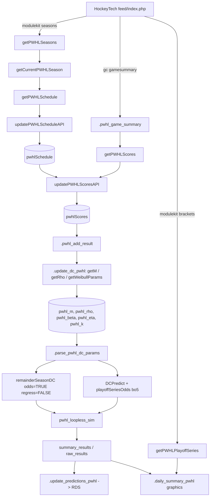

# PWHL modelling reference (for agents)

Read this before PWHL calculation/modelling work instead of exploring the package. It was checked against the `R/` source on 2026-10-23. Items marked (?) are inferred and not confirmed.

## Contents

1. [Files at a glance](#files-at-a-glance)
2. [Data flow](#data-flow)
3. [HockeyTech API](#hockeytech-api)
4. [Package data and key columns](#package-data-and-key-columns)
5. [Model method](#model-method)
6. [Season simulation, standings and playoffs](#season-simulation-standings-and-playoffs)
7. [Differences from the NHL pipeline](#differences-from-the-nhl-pipeline)
8. [Function tables](#function-tables)
9. [Conventions](#conventions)
10. [Gotchas and inconsistencies](#gotchas-and-inconsistencies)

## Files at a glance

| File | PWHL role |
|---|---|
| `R/pwhl-api-fetch.R` | API constants, request builder, seasons, schedule, scores, playoff brackets, season-state checks, team colours rebuild |
| `R/pwhl-model-core.R` | `Result` encoding, DC fit (`.update_dc_pwhl`), param parsing, model update, `pwhl_in_season`, `pwhl_loopless_sim` |
| `R/pwhl-daily-summary.R` | `.daily_summary_pwhl`: update → graphics → social posts → season sim (only if in season) |
| `R/constants.R` | `DC_XI_PWHL = 0.05`, `DC_UPSILON_PWHL = 461.0156`, `DC_NU_PWHL = 5` |
| `R/data.R` | Docs for `pwhlTeamColours`, `pwhlSchedule`, `pwhlScores`, `pwhl_m`, `pwhl_rho`, `pwhl_beta`, `pwhl_eta`, `pwhl_k` |
| `R/frontend-core.R` | League dispatch (`"pwhl"`), `.update_predictions_pwhl`, `.pwhl_prediction_summary`, `.default_pwhl_graphics_dir` |
| `R/frontend-season.R` | `inRegularSeason`/`inPlayoffs`/`inOffSeason(league = "PWHL")` dispatch to `.in_*_pwhl` |
| `R/frontend-plots.R` | `.today_odds_plot_pwhl` |
| `R/frontend-daily-summary.R` | `dailySummary()` calls `.daily_summary_pwhl` |
| `R/optimize-model-parameters.R`, `R/tune_weights.R` | `league = "PWHL"` tuning/audits (`.tune_dc_weight`, `.audit_model_constants`, OT/SO rate tests) |
| `R/graphics-*.R` | Use `league = "PWHL"` and `pwhlTeamColours` for plotting |

PWHL does **not** appear in `metrics.R`, `validation-helpers.R` or `utils-export.R`. `package-setup.R:99` mentions PWHL only in a comment.

## Data flow

`.update_model_pwhl()` runs schedule → scores → fit.

## HockeyTech API

- Base: `https://lscluster.hockeytech.com/feed/index.php`. The public `key` (`PWHL_API_KEY`) and `client_code = "pwhl"` are added to every request (`pwhl-api-fetch.R:4-17`).
- Caching: `httr2::req_cache(tempdir())` plus `req_retry(max_seconds = 120)`. The cache is per R session (`tempdir()`) and follows HTTP cache headers.

| Query | Used by | Response path |
|---|---|---|
| `feed=modulekit&view=seasons` | `getPWHLSeasons` | `SiteKit$Seasons` → `id, name, shortname, career, playoff, start_date, end_date` |
| `feed=modulekit&view=schedule&season_id=` | `getPWHLSchedule` | `SiteKit$Schedule` (`date_played, home_team_code, visiting_team_code, id, status, game_status`) |
| `feed=gc&tab=gamesummary&game_id=&lang=en` | `.pwhl_game_summary` | `GC$Gamesummary` (`meta$status`, `meta$period`, `goalCount`, `shootoutDetail`, `home/visitor$team_code`) |
| `feed=modulekit&view=brackets&season_id=` | `getPWHLPlayoffSeries` | `SiteKit$Brackets$rounds$matchups` |

- Status codes: `"4"` means Final and `"1"` means Scheduled. For any other code, the raw `game_status` text is used.
- `OTStatus`: `""` when `period == 3`. When `period == 4`, it is `"SO"` if `shootoutDetail` is non-empty and `"OT"` otherwise. Any other period count gives `"OT"`.
- Seasons: `career == 1` marks real (regular or playoff) seasons, and `playoff == 1` marks playoff seasons. Each playoff season has its own season ID.

## Package data and key columns

- `pwhlSchedule`: `Date, HomeTeam, AwayTeam, GameID (int), GameType ("R"/"P"), GameStatus ("Final"/"Scheduled"/text)`. Covers the **current season only**.
- `pwhlScores`: the schedule columns plus `HomeGoals, AwayGoals, OTStatus ("", "OT", "SO")`. Holds history across seasons.
- `pwhlTeamColours`: `Team`, colours, short code, hashtag, `Division`/`Conference` (both `"PWHL"`), `PWHLID`. Built from `data-raw/logos/pwhl_team_colours.csv`.
- Team names come from short codes via `.getLongTeam(code, pwhlTeamColours)`. Brackets use `PWHLID` via `.pwhl_resolve_team_name`. Games with an unresolved team (`NA`) are dropped from the schedule.

## Model method

- The NHL Dixon-Coles machinery is reused with PWHL data and constants (`.update_dc_pwhl`, `pwhl-model-core.R:52`):
  1. Filter to `GameStatus == "Final"`, then `.pwhl_add_result`.
  2. `getM(xi, upsilon, nu)`: Poisson GLM for attack/defence/home, with time weights from `.DCweights`.
  3. `getRho`: low-score correction.
  4. `getWeibullParams` → `beta, eta, k`: tie enhancement.
- `Result` encoding (home perspective): 1 = regulation win, 0.75 = OT win, 0.6 = SO win, 0.4 = SO loss, 0.25 = OT loss, 0 = regulation loss. Anything else (a tie) gets 0.5.
- Weights: within-season sigmoid `1 - 1/(1+exp(-xi*(days_old - upsilon)))` times the cross-season factor `1/(1+s^nu)`. PWHL uses a steep `xi` and `nu = 5`, which heavily discounts past seasons because of expansion-draft churn. NHL uses `nu = 0`.
- If `currentDate != Sys.Date()`, the fit is a backtest: it uses only games before that date and forces `save_data = FALSE`.
- Game probabilities: `DCPredict` / `remainderSeasonDC` with PWHL params give `HomeWin, AwayWin` and the draw remainder. `.extraTimeSolver` splits the draw remainder into home and away extra-time wins. Each extra-time win is then split into OT and SO with the **NHL hard-coded** 0.6858606 / 0.3141394 ratio (`pwhl-model-core.R:316-319`).
- Points system: PWHL uses **3-2-1-0** (regulation win 3, OT/SO win 2, OT/SO loss 1). The NHL uses 2-2-1-0.

## Season simulation, standings and playoffs

`pwhl_loopless_sim(nsims = 1e4, scores, schedule, params, odds_table)` (`pwhl-model-core.R:240`):

1. Keeps only regular-season games (`GameType == "R"`). Aborts if the schedule has no regular-season games or if fewer than 4 teams are found.
2. Builds the odds table with `remainderSeasonDC(..., odds = TRUE, regress = FALSE)`, using games after the last score date.
3. Combines played games (from the season start date, with known `Result`) with future odds. Played `GameID`s are removed from the odds table.
4. Each simulation samples a `Result` per future game with `.sampleResult` (six outcomes).
5. Standings: 3-2-1-0 points and `W` (regulation wins only). Teams are ranked by points with `ties.method = "random"`, so **no real tiebreakers are applied** (real PWHL tiebreaks start with regulation wins (?)). The top 4 make the playoffs, and there are no divisions or conferences.
6. Playoffs: 1 v 4 and 2 v 3, then a final. Every round is best-of-5 with home pattern `c(T,T,F,F,T)` (2-2-1), and the higher seed has home ice. Series odds are precomputed for all pairs with `playoffSeriesOdds(DCPredict(draws = FALSE))`. Real PWHL lets the 1 seed choose its semi-final opponent; this is not modelled (?).
7. Output `summary_results` columns: `Team, Make_Playoffs, Make_Finals, Win_Cup, meanPoints, maxPoints, minPoints, meanWins, sdPoints, sdWins, meanRank, bestRank`. `raw_results` has `Team, SimNo, Points, W, Rank, MakePlayoffs, Finals, Champion`.
8. `.pwhl_prediction_summary` reduces the results to `Team, Playoffs, meanPoints, Presidents (P(rank 1))`. They are saved as `<data_dir>/pwhl/<date>-predictions.RDS`, and the step is skipped if the file already exists.

The simulation is a serial `purrr::map_dfr` loop. It is slow at 1e4 sims, but `nsims = 1e4` is what the daily summary uses.

## Differences from the NHL pipeline

| Aspect | NHL (`nhl-dixon-coles-*.R`, `nhl-league-*.R`) | PWHL |
|---|---|---|
| Data source | NHL API, `scores`/`schedule` | HockeyTech, `pwhlScores`/`pwhlSchedule` |
| Params | `m, rho, beta, eta, k` via `.parse_dc_params` | `pwhl_*` via `.parse_pwhl_dc_params` (wraps the same function) |
| Weights | `DC_XI_NHL = 0.00426`, `DC_UPSILON_NHL = 365`, `DC_NU_NHL = 0` | 0.05 / 461.0156 / 5 |
| Points | 2-2-1-0 | 3-2-1-0 |
| Regression to mean | `remainderSeasonDC(regress = TRUE)` | `regress = FALSE` |
| Simulation | `loopless_sim` / `simulateSeasonParallel`, with parallel options | `pwhl_loopless_sim`, serial |
| Standings | Division/conference ranks, wildcards (`buildStats`, `nhl-league-standings.R`) | Single table, random tie-break |
| Playoffs | 16 teams, best-of-7, `simulatePlayoffs`/`playoffSolverEngine` | 4 teams, best-of-5 (2-2-1), inline in the sim |
| OT/SO split | 0.6858606 / 0.3141394 | Same NHL constants (no PWHL-specific values) |

## Function tables

### `R/pwhl-api-fetch.R`

| Function | Exp | Purpose | Inputs → Output |
|---|---|---|---|
| `.pwhl_api_request` | | Builds an httr2 request with key, client, cache and retry | `params` list → request |
| `getPWHLSeasons` | ✓ | Lists all seasons | → df `id, name, shortname, career, playoff, start_date, end_date` |
| `getCurrentPWHLSeason` | ✓ | Active `career==1` season ID, or else the max ID | → int or `NULL` |
| `.in_regular_season_pwhl` (alias `.inRegularSeasonPWHL`) | | Is the date in a regular season? Playoff windows win; falls back to the schedule | `date, boolean, schedule` → lgl or season ID chr |
| `.in_playoffs_pwhl` (alias `.inPlayoffsPWHL`) | | Same check for playoffs | same |
| `.in_off_season_pwhl` | | `TRUE` if the date is in no `career==1` season | `date, schedule` → lgl |
| `getPWHLSchedule` | ✓ | Season schedule; `GameType` comes from the season's `playoff` flag | `season, pwhlTeamColours` → schedule df |
| `getPWHLScores` | ✓ | Loops over `.pwhl_game_summary` | `gameIDs, progress` → scores df or `NULL` |
| `.pwhl_resolve_team_name` | | `PWHLID` → Team | `pwhlID` → chr |
| `.pwhl_game_summary` | | One finished game | `gid` → 1-row df or `NULL` |
| `pwhl_games_today` | ✓ | Scheduled games on a date | `schedule, date` → df or `NULL` |
| `updatePWHLScheduleAPI` | ✓ | Current-season schedule; optional `use_data` | `save_data` → df |
| `updatePWHLScoresAPI` | ✓ | Fetches past games that are not yet Final (or all, if `full_season`); merges and dedupes | `pwhlScores, schedule, full_season, save_data` → df |
| `getPWHLPlayoffSeries` | ✓ | Bracket series state | `season_id` → df `HomeTeam, AwayTeam, HomeWins, AwayWins, Status` or `NULL` |
| `.buildPWHLTeamColours` | | Rebuilds the colours data from CSV | → invisible `NULL` |

### `R/pwhl-model-core.R`

| Function | Exp | Purpose | Inputs → Output |
|---|---|---|---|
| `.pwhl_add_result` | | Adds the numeric `Result` | scores → scores + `Result` |
| `.update_dc_pwhl` | | Fits DC params; optional `use_data` | `scores, currentDate, xi, upsilon, nu, save_data` → list `m, rho, beta, eta, k` |
| `.parse_pwhl_dc_params` | | Normalises params with PWHL defaults | `params` → list |
| `.update_model_pwhl` | | Schedule → scores → fit | `save_data` → list `scores, schedule, params` |
| `pwhl_in_season` | ✓ | Date within the schedule's min–max dates (all game types) | `date (Date), schedule` → lgl |
| `.pwhl_season_start_date` | | First regular-season date | schedule → Date or `NA` |
| `pwhl_loopless_sim` | ✓ | Monte Carlo season plus playoffs | see above → list `summary_results, raw_results` |

### `R/pwhl-daily-summary.R` (calculation parts)

`.daily_summary_pwhl(graphic_dir, ...)` runs these steps in order:

1. Returns early if `inOffSeason("PWHL")`.
2. Calls `.update_model_pwhl()` and `.parse_pwhl_dc_params`.
3. Builds today's odds plot and table (`league = "PWHL"`).
4. Makes `plot_team_rating(m = params$m)`.
5. If `getPWHLPlayoffSeries()` returns series, makes the series odds plot and table.
6. If `pwhl_in_season()` and regular-season games remain after today, runs `pwhl_loopless_sim(1e4)` and makes the playoff-odds table.

All graphics steps are wrapped in `tryCatch(..., NULL)`.

### Other PWHL-aware helpers

`.update_predictions_pwhl`, `.pwhl_prediction_summary`, `.default_pwhl_graphics_dir` (`frontend-core.R`); `.today_odds_plot_pwhl` (`frontend-plots.R`). Tuning: `.tune_dc_weight(league="PWHL")`, `.audit_model_constants(pwhl_scores=)` and OT-rate tests in `optimize-model-parameters.R`. `optimize-model-parameters.R:763` falls back to the NHL Weibull params when `pwhl_*` is `NULL`.

## Conventions

- PWHL-specific functions are snake_case with a `pwhl` prefix or suffix (`pwhl_loopless_sim`, `.update_dc_pwhl`). The older API functions use camelCase (`getPWHLScores`). The camelCase aliases `.inRegularSeasonPWHL` and `.inPlayoffsPWHL` are kept.
- Parameter lists are always passed through `.parse_pwhl_dc_params()`. Never pass `NULL` straight into shared DC functions, because they default to the **NHL** params.
- `save_data = TRUE` writes package data via `usethis::use_data` and must be run from the package root.
- Errors use `cli::cli_abort`; API failures inside loops use `message` and are skipped.

## Gotchas and inconsistencies

1. **`nu` default doc mismatch**: the `.update_dc_pwhl` roxygen says `DC_NU_PWHL` is 2, but `constants.R:63` sets 5.
2. **`GameType` in `.pwhl_game_summary` comes from installed `HockeyModel::pwhlSchedule`**, not from the `schedule` argument. Games missing from the installed data get `GameType = ""` and are then excluded from `GameType == "R"` filters until the package data is rebuilt.
3. **`getPWHLSchedule` sets a single `GameType` for the whole season** (`"P"` when the season ID is a playoff season). Regular and playoff schedules are separate season IDs.
4. **`getCurrentPWHLSeason` can return a playoff season ID** in the off-season, because `max(id)` is taken over `career == 1`, which includes playoff seasons. `updatePWHLScheduleAPI` would then store an all-`"P"` schedule, and `pwhl_loopless_sim` aborts.
5. **SO detection assumes a shootout shows as `period == 4`** with `shootoutDetail`. Whether HockeyTech reports a shootout as period 5 (?) is unverified; if it does, an SO would be coded as `"OT"`. Five-or-more-period games are always `"OT"`.
6. **OT/SO split uses NHL constants**. `OT_PROB_PWHL`/`SO_PROB_PWHL` exist only as audit labels (`optimize-model-parameters.R:1057`).
7. **No tiebreakers**: ranks use random ties.
8. **`getPWHLPlayoffSeries` reads only `matchups[[1]]`** (the first round), and its `Status` uses a hard-coded 3-win threshold (best-of-5).
9. **`pwhl_in_season` includes playoff dates**, because it uses the full schedule range. `.pwhl_season_start_date` uses regular-season games only. `pwhl_in_season` requires a `Date` (no coercion), unlike `.in_*_pwhl`, which use `.coerce_date`.
10. **`remainderSeasonDC` still calls `.add_postponed_to_schedule_end`** and NHL-oriented history logic on PWHL data. This is believed harmless (?).
11. `pwhl_games_today` accepts `GameStatus` of `"Scheduled"` or `"1"`.
12. API caching to `tempdir()` means results can be stale within one session.
13. Teams in the schedule that never appear in `pwhl_m` will make `DCPredict` fail (e.g. after expansion, before any games are played) (?).
